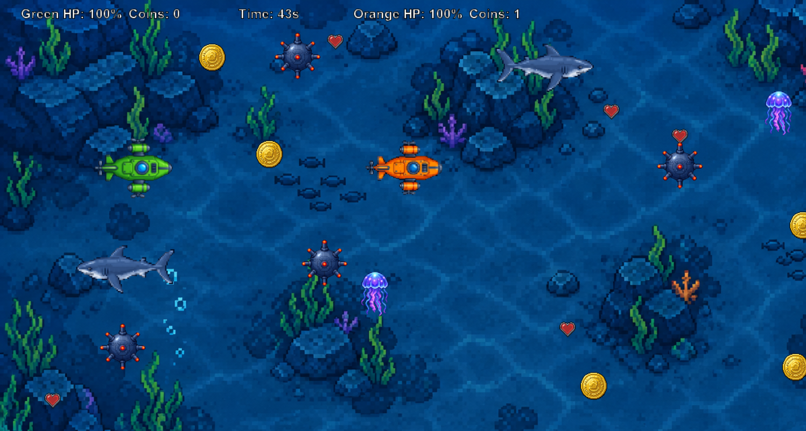
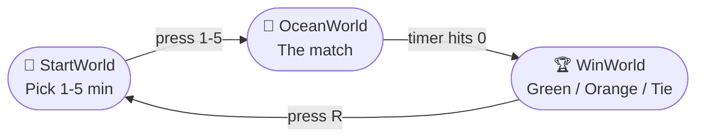

<div align="center">

# 🌊 DeepSeaDiver 🤿

### Two subs. One ocean. Grab the gold before the deep grabs you.


-0288d1?style=for-the-badge)




</div>

---

## What is this?

**DeepSeaDiver** is a local two-player, head-to-head arcade game built with **Java** and **[Greenfoot](https://www.greenfoot.org/)**. Pilot your submarine through a pixel-art ocean floor, scoop up as many **gold coins** as you can, and stay alive while sharks patrol, jellyfish drift, and sea mines wait for a bad turn.

When the clock hits zero, whoever has more coins takes the trophy. 🏆

---

## Controls

Both players share one keyboard. Subs steer like real boats: **turn**, then **thrust**.

| Action | 🟢 Green Sub (Player 1) | 🟠 Orange Sub (Player 2) |
|---|:---:|:---:|
| Move forward | `W` | `↑` |
| Reverse | `S` | `↓` |
| Turn left | `A` | `←` |
| Turn right | `D` | `→` |

| Screen | Key |
|---|---|
| Pick match length | `1` `2` `3` `4` `5` (minutes) |
| Play again after a match | `R` |

---

## How to play

1. **Choose your dive time**: press `1`–`5` on the title screen for a 1 to 5 minute match.
2. **Collect coins** 🪙 to score. Each coin is worth 1 point, and a new one pops up somewhere else right after.
3. **Grab hearts** ❤️ to heal.
4. **Dodge the danger.** Taking a hit gives you a brief moment of ghostly invincibility, so you won't get chain-hit.
5. **Out of HP?** You respawn after 3 seconds with full health and a short shield.
6. **Most coins when the timer ends wins.** Equal coins means a tie.

---

## 🌊 What's down there

| | Thing | What it does |
|:---:|---|---|
| 🪙 | **Gold Coin** | +1 score. Respawns at a random spot when collected. |
| ❤️ | **Heart Emblem** | Restores **10 HP** (max 100). Respawns when collected. |
| 💣 | **Sea Mine** | Explodes on contact for **20 damage**, then respawns elsewhere. |
| 🪼 | **Jellyfish** | Drifts randomly. Its sting deals **15 damage**. |
| 🦈 | **Shark** | Patrols the ocean edge to edge and flips to face its direction. A bite deals **15 damage**. There are two sharks, and the second is faster. |

Sound effects play for coins, stings, bites, explosions, and victory, with looping music during the match and on the win screen.

---

## Run it yourself

### Prerequisites
- **Java JDK** (Greenfoot ships with one, so you usually don't need a separate install)
- **[Greenfoot](https://www.greenfoot.org/download)**

### Steps
```bash
# 1. Clone the repo
git clone https://github.com/rhjazzraymundo/DeepSeaDiver.git
```
2. Open **Greenfoot** → **Scenario → Open…**
3. Select the cloned `DeepSeaDiver` folder (the one containing `project.greenfoot`).
4. Click **Compile All**, then press **Run** ▶️.
5. On the title screen, press `1`–`5` and dive in.

> 💡 Keep the `images/` and `sounds/` folders next to the `.java` files, or the sprites and audio won't load.

---

## 🗺️ Game flow



---

## 🧱 Project structure

```
DeepSeaDiver/
├── StartWorld.java      # Title screen and match-length picker
├── OceanWorld.java      # Main arena: spawning, HUD, timer, end-of-match logic
├── WinWorld.java        # Results screen (winner, score, replay)
├── Submarine.java       # Player: controls, collisions, health, respawn, i-frames
├── Shark.java           # Patrolling enemy, mirrors sprite when turning
├── Jellyfish.java       # Randomly drifting enemy
├── SeaMine.java         # Explosive hazard with respawn
├── GoldCoin.java        # Score pickup
├── HeartEmblem.java     # Healing pickup
├── images/              # Sprites and backgrounds
├── sounds/              # SFX and music
└── project.greenfoot    # Greenfoot project file
```

---
